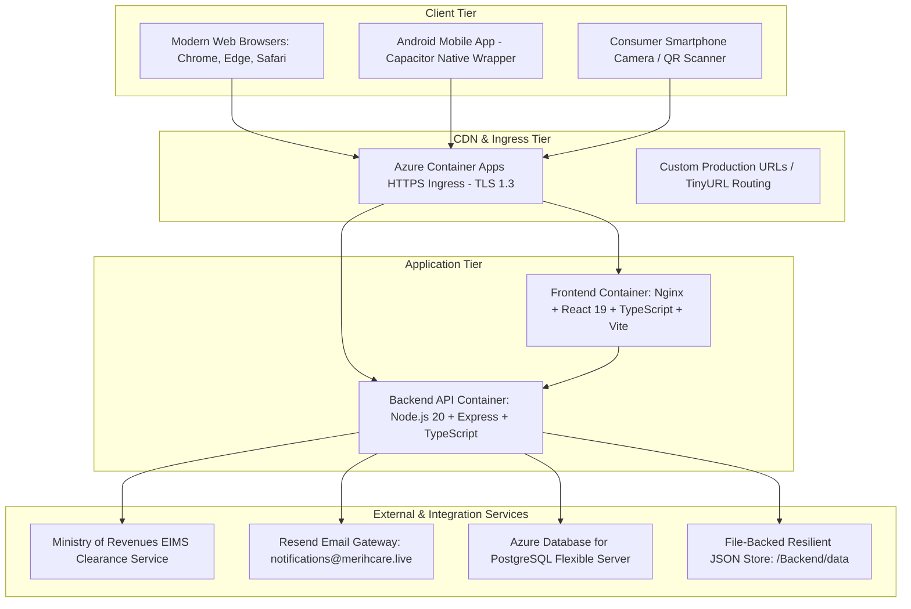
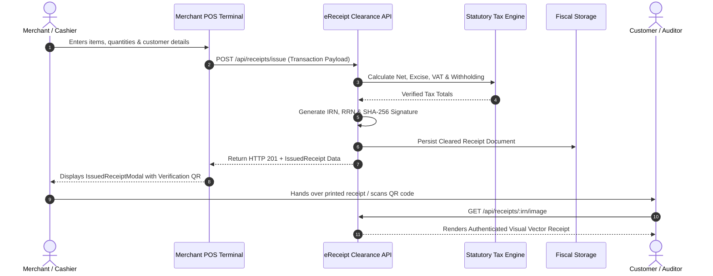
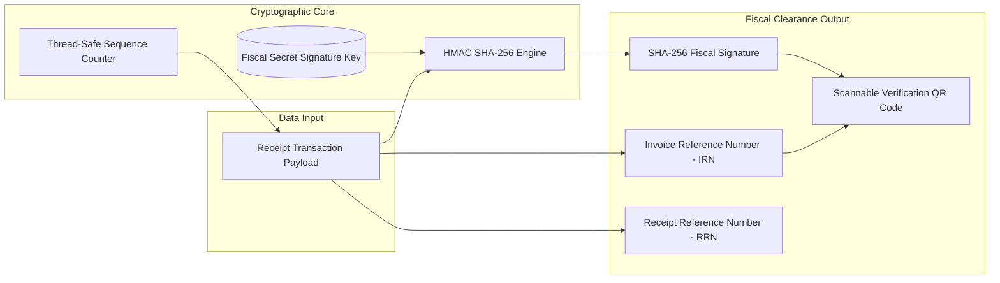
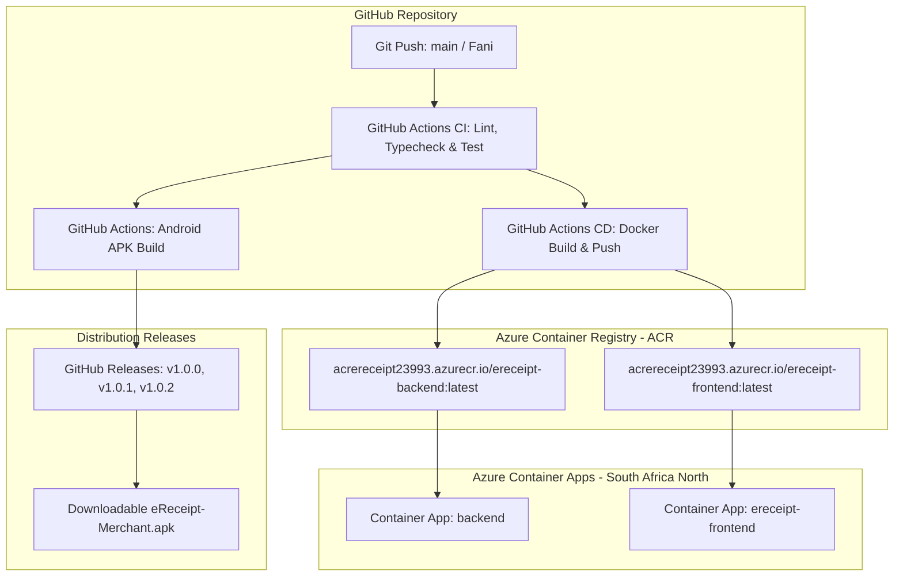

# eReceipt — National Digital Receipt & Tax Administration Platform
## Comprehensive Architectural, Technical & Operational Documentation

**System Version:** 1.0.2  
**Target Authority:** Ministry of Revenues (MoR) — Electronic Invoice Management System (EIMS)  
**Deployment Infrastructure:** Microsoft Azure Container Apps (South Africa North) & Native Android (Capacitor)  
**Document Revision:** October 2026  
**Document Confidentiality:** Confidential / Academic & Technical Evaluation  

### Group Project Members & Subsystem Responsibilities

| No. | Full Name | Student ID | System Role & Subsystem Ownership (README & Architecture) |
|:---:|:---|:---:|:---|
| 1 | **Fanuel Goitom** | `CTC-1673-26` | **Mobile App Development & Deployment / System Architecture Lead**<br>Capacitor Native Android Mobile POS, Azure Container Apps Cloud Hosting, Automated GitHub Actions CI/CD, Zero-Drop Session Persistence |
| 2 | **Fiema Yaregal Belie** | `CTC-2506-26` | **Database & Figma Design / Merchant Onboarding Lead**<br>Relational Database Schema Design, Figma UI/UX Prototypes, Merchant Registration & Document Verification, Secure Password Recovery Flow |
| 3 | **Fikrte Gebretsadkan** | `CTC-5776-26` | **Backend / Tax Administrator (Gebiwoch) Fiscal Oversight Lead**<br>Admin Fiscal Oversight Engine, Merchant Application Review Queue & Approvals, Central MoR Audit Logging, Statutory EIMS Tax Calculation Compliance |
| 4 | **Fuad Aman Gebi** | `CTC-3534-26` | **Frontend / Merchant Authentication & Security Lead**<br>Frontend Interface Engineering, Merchant JWT Authentication & Argon2id Security, REST API Client Layer, Dual B2B/B2C Mode Selectors |
| 5 | **Gelila Sintayehu** | `CTC-5358-26` | **Backend & Integration / Visual QR Verification Lead**<br>Git Repository Governance & Release Pipeline, Visual Vector Receipt Image QR Engine (SVG / Data-URI Fallback), Public Receipt Verification Subsystem |
| 6 | **Gemechu Teso Delesa** | `CTC-246-26` | **Frontend / Merchant Workspace & POS Subsystem Lead**<br>Merchant Dashboard & Responsive Settings Console, Point-of-Sale (POS) Receipt Issuance Interface, Tax Invoice Clearance Preview & Sales Records Ledger |

---

## Table of Contents

1. [Executive Summary](#1-executive-summary)
2. [Regulatory Context & Compliance (MoR EIMS)](#2-regulatory-context--compliance-mor-eims)
3. [System Architecture & High-Level Design](#3-system-architecture--high-level-design)
4. [Platform Subsystems & Feature Breakdown](#4-platform-subsystems--feature-breakdown)
   - 4.1 [Merchant Onboarding & Self-Service Registration](#41-merchant-onboarding--self-service-registration)
   - 4.2 [Tax Authority & Revenue Officer Portal (Admin)](#42-tax-authority--revenue-officer-portal-admin)
   - 4.3 [Point-of-Sale (POS) & Receipt Issuance Engine](#43-point-of-sale-pos--receipt-issuance-engine)
   - 4.4 [Statutory Ethiopian Tax Calculation Engine](#44-statutory-ethiopian-tax-calculation-engine)
   - 4.5 [Visual Vector Receipt Image & QR Verification Subsystem](#45-visual-vector-receipt-image--qr-verification-subsystem)
   - 4.6 [Merchant Workspace, Sales Ledger & Audit Reporting](#46-merchant-workspace-sales-ledger--audit-reporting)
   - 4.7 [Native Android Mobile Application (Capacitor)](#47-native-android-mobile-application-capacitor)
   - 4.8 [State Management & Session Persistence Architecture](#48-state-management--session-persistence-architecture)
5. [Security, Cryptography & Data Integrity](#5-security-cryptography--data-integrity)
6. [Comprehensive REST API Specification](#6-comprehensive-rest-api-specification)
7. [Data Models & Schema Reference](#7-data-models--schema-reference)
8. [Cloud Infrastructure, Containers & CI/CD Pipelines](#8-cloud-infrastructure-containers--cicd-pipelines)
9. [Local Development, Build & Configuration Guide](#9-local-development-build--configuration-guide)
10. [End-to-End Operational Workflows & User Guides](#10-end-to-end-operational-workflows--user-guides)

---

## 1. Executive Summary

**eReceipt** is an enterprise-grade digital fiscal receipting and tax administration platform engineered to digitize commercial transactions across Ethiopia. Designed to interface seamlessly with the **Ethiopian Ministry of Revenues (MoR) Electronic Invoice Management System (EIMS)**, the platform replaces manual, error-prone paper receipt pads and expensive physical fiscal cash registers with a modern, cloud-connected digital solution.

### Primary Platform Capabilities:
- **Dual-Portal Web Experience**: Dedicated web workspaces for commercial merchants and tax authority revenue officers.
- **Cross-Platform Mobile POS**: A native Android APK delivering 1-tap receipt generation, GPS verification, offline transaction draft auto-saving, and thermal printer integration.
- **Statutory Ethiopian Tax Engine**: Automatic calculation of Unit Net, 15% Standard VAT, Commodity-Specific Excise Tax, and 2% Withholding Tax with dynamic B2B vs. B2C threshold enforcement.
- **Cryptographic Fiscal Clearance**: Real-time generation of unique Invoice Reference Numbers (IRN), Receipt Reference Numbers (RRN), sequential fiscal numbering (`[MERCHANT]-[REGISTER]-[YEAR]-[SEQUENCE]`), and SHA-256 HMAC digital signatures.
- **Visual Receipt Image QR Codes**: QR codes that render human-readable, vector-graphic receipts (SVG/PNG) on any mobile phone camera or barcode scanner without requiring proprietary software.
- **Zero-Drop Session Persistence**: Resilient local-state caching ensuring merchants and tax officers stay logged in across browser refreshes and mobile app process terminations.

---

## 2. Regulatory Context & Compliance (MoR EIMS)

The platform is designed in accordance with Ethiopian revenue administration directives, specifically fulfilling the requirements of the Electronic Invoice Management System (EIMS):

| Regulation Requirement | Platform Implementation |
|---|---|
| **Taxpayer Identification Number (TIN)** | Real-time 10-digit numeric TIN validation against the MoR taxpayer database. |
| **B2B Commercial Identity** | Mandatory capture of buyer legal business name and verified 10-digit TIN for all business-to-business transactions. |
| **B2C Consumer Protection** | Walk-in consumer receipts require no mandatory TIN or Fayda National ID (FIN), protecting consumer privacy while maintaining fiscal integrity. |
| **Sequential Audit Numbering** | Thread-safe sequence counters bound to registered terminal codes (`BRANCH_CODE` / `REGISTER_CODE`) preventing backdating or missing invoice numbers. |
| **Fiscal Cryptographic Proof** | Every transaction is signed using a cryptographic HMAC key, outputting an immutable signature stamped onto both the receipt payload and the QR code. |
| **Withholding Tax Exemption Rules** | Statutory 2% withholding is enforced strictly for B2B transactions where goods exceed 10,000 ETB or services exceed 3,000 ETB and the buyer holds accredited Withholding Agent status. |

---

## 3. System Architecture & High-Level Design

The system implements a decoupled, modern multi-tier architecture containerized with Docker and orchestrated on **Microsoft Azure Container Apps**:



### Architectural Highlights:
1. **Frontend Service**: High-performance single-page application (SPA) built using React 19 and TypeScript, bundled with Vite, and served via an Alpine-based Nginx edge server configured for client-side push-state routing.
2. **Backend Service**: Asynchronous RESTful service built with Express and TypeScript, implementing controller-service-repository patterns, idempotency middleware, and LAN IP broadcast capabilities for cross-device testing.
3. **Storage Abstraction**: Hybrid persistence supporting enterprise PostgreSQL Flexible Server alongside an embedded, atomic JSON document store for fail-safe zero-dependency execution.
4. **Mobile Native Bridge**: Apache Capacitor 8 native Android shell providing hardware camera access, location services (GPS), local storage persistence, and native splash screens.

---

## 4. Platform Subsystems & Feature Breakdown

### 4.1 Merchant Onboarding & Self-Service Registration
Merchants can register their business either via the web portal or the Android application:
- **TIN Verification**: Validates the 10-digit Ethiopian TIN against Ministry records before allowing progression.
- **Business Profile Capture**: Captures legal company name, trade name, business license number, physical address (City, Sub-City, Building, Floor), and GPS coordinates.
- **Hardware Geolocation**: One-tap GPS coordinate retrieval utilizing browser Geolocation APIs on the web and `@capacitor/geolocation` on mobile devices.
- **Document Attachment**: Upload of PDF or image copies of the business license and commercial registration certificates.
- **Email Verification (OTP)**: Direct dispatch of numeric one-time verification passwords (OTP) via the verified email gateway (`notifications@merihcare.live`) directly to the applicant's email address.
- **Real-Time Status Synchronization**: Automatically initializes the merchant status as `Pending`, storing an immutable reference identifier (`REF-XXXXX`).

### 4.2 Tax Authority & Revenue Officer Portal (Admin)
Revenue officers access a secure administrative interface (`tinyurl.com/admin-erecipt`):
- **Officer Authentication**: Multi-officer JWT-based authentication system supporting role-based access.
- **Real-Time Metrics Overview**: Summary dashboard detailing total registered merchants, pending applications, approved businesses, live cleared transactions, and cumulative tax revenues collected.
- **Application Review Queue**: Comprehensive review interface displaying submitted business details, GPS locations, and uploaded registration documents.
- **Decision Engine with Audit Trail**:
  - **Approve**: Transitions merchant status to `Approved` and `Active`, generating an official merchant identifier (`MER-XXXXX`) and activating their clearance privileges.
  - **Reject with Cause**: Prompts the officer for a mandatory statutory justification reason, automatically logged to the immutable audit ledger.
- **Merchant Directory & Compliance Controls**: Searchable catalog of all registered taxpayers with administrative status toggle controls (`Active` vs. `Suspended`).
- **Unified Tax Ledger**: Real-time cross-merchant ledger consolidating all cleared transactions, VAT collections, excise taxes, and withholding remittances.

### 4.3 Point-of-Sale (POS) & Receipt Issuance Engine
Located in `Frontend/ereceipt/src/features/receipt-issuance`:
- **Document Classification**:
  - `Electronic Tax Invoice (VAT Invoice)`: Standard commercial invoice with line-item VAT.
  - `Cash Sale Receipt`: Simplified walk-in consumer receipt.
  - `Credit Note / Debit Note`: Fiscal adjustments requiring reference to the original cleared IRN and statutory adjustment reason codes.
- **Transaction Mode Selection**: `B2B / Registered Buyer` vs. `B2C / Walk-in Customer`.
- **Dynamic Product Cart**: Flexible line items supporting unit prices, quantities, units of measure (pcs, kg, liters, hours), line discounts, and commodity-specific tax rates.
- **Automatic Draft Recovery**: POS drafts are continuously synchronized to `localStorage.getItem('ereceipt:pos_draft')`, ensuring zero data loss if a browser tab is accidentally closed.
- **Issued Receipt Modal (`IssuedReceiptModal.tsx`)**:
  - Official clearance record with green MoR Cleared badge.
  - Prominent **`← Back`** button in the header and **`← Go Back`** in the footer for frictionless return to the sales terminal.
  - 80mm thermal receipt printer output via window print simulation.
  - One-click copy of the public verification URL.
  - Vector PNG/SVG download for digital dispatch via SMS, email, or Telegram.



### 4.4 Statutory Ethiopian Tax Calculation Engine
The platform calculates taxes according to current Ethiopian fiscal statutes:

$$\text{Net Line Amount} = (\text{Unit Price} \times \text{Quantity}) - \text{Discount}$$

$$\text{Line Excise Tax} = \text{Net Line Amount} \times \left(\frac{\text{Excise Rate}}{100}\right)$$

$$\text{Line VAT (15\%)} = (\text{Net Line Amount} + \text{Line Excise Tax}) \times 0.15$$
*(Zero-Rated and Exempt items produce 0% VAT)*

$$\text{Withholding Tax (2\%)} = \text{Eligible Subtotal} \times 0.02$$
*(Triggered exclusively for B2B transactions where Goods Subtotal > 10,000 ETB or Services Subtotal > 3,000 ETB and buyer is a designated agent)*

$$\text{Grand Total} = \text{Subtotal} + \text{Excise Tax} + \text{VAT} - \text{Withholding Tax}$$

### 4.5 Visual Vector Receipt Image & QR Verification Subsystem
Unlike conventional systems that encode unreadable raw text strings into QR codes, eReceipt generates intelligent QR codes supporting multiple display paradigms:
1. **Interactive Web Viewer (`/?view=receipt-image&irn=...&data=...`)**:
   - Bilingual support: One-click instant toggle between English and Amharic (አማርኛ).
   - Display Themes: Toggle between Standard Commercial Tax Invoice and 80mm POS Thermal Cash Slip.
   - High-density client data embedding guaranteeing rendering even during network connectivity drops.
2. **Direct Vector Image Endpoint (`/api/receipts/:irn/image`)**:
   - Backend dynamically renders an SVG vector image complete with the Ministry of Revenues emblem, clearance status pill, itemized grid, tax breakdown, and digital signature stamp.
3. **Data URI Embedded Vector Graphic (`data:image/svg+xml;utf8,...`)**:
   - Self-contained SVG image encoded directly into the QR code matrix, allowing offline camera scanners to open the visual receipt without executing server network calls.

### 4.6 Merchant Workspace, Sales Ledger & Audit Reporting
Located in `Frontend/ereceipt/src/features/audit`:
- **Sales Records**: Real-time chronological ledger of all cleared transactions with status filtering (`Cleared`, `Submitted`, `Adjusted`).
- **Periodic Tax Calculation Report**: Aggregates income, deductible expenses, taxable base, and calculated tax liabilities for monthly/quarterly tax reporting, complete with one-click CSV export (`approved-tax-calculation-report.csv`).
- **Audit Event Log**: Chronological security log recording login timestamps, receipt clearances, status modifications, and profile changes.
- **Responsive Settings Console**: Single-column and responsive pill navigation adapting to desktop monitors, tablets, and mobile screens. Allows managing company contact data, notification preferences, security credentials, and language settings.

### 4.7 Native Android Mobile Application (Capacitor)
Packaged as `eReceipt-Merchant.apk` and available through GitHub Releases:
- **Dedicated Bottom Navigation**: Fast, thumb-friendly navigation bar featuring **Home**, **Sales History**, **1-Tap Center POS Action**, **Tax Records**, and **Settings**.
- **Branded Launch Experience**: Custom app icon and native launch splash screen adhering to official Ethiopian brand guidelines.
- **Hardware Integration**: Native camera QR scanning and GPS location acquisition.
- **Persistent Mobile Auth**: Unlike standard web browsers that clear session cookies on exit, the mobile application maintains active merchant sessions across full app closures and system restarts.

### 4.8 State Management & Session Persistence Architecture
To prevent unexpected session terminations, the platform implements an authoritative multi-tiered storage architecture:
- **Authentication Tokens**: `ereceipt_token`, `merchant_token`, `officer_token`, and user profiles are stored in persistent `window.localStorage`.
- **Navigation State Cache**: Active view (`ereceipt_active_view`), active merchant screen (`ereceipt_active_screen`), and active admin tab (`ereceipt_admin_page`) are synchronized across both `localStorage` and `sessionStorage`.
- **URL Resolver (`parseUrlState`)**: On page load, refresh, or mobile app cold boot, the URL resolver inspects storage keys. If valid authentication credentials exist, it immediately restores the merchant or officer directly into their active workspace rather than redirecting to the landing page.
- **Security Boundaries**: Explicit invocation of "Sign Out" completely purges all authentication tokens, cached profiles, and routing keys, redirecting users cleanly to the landing portal.

---

## 5. Security, Cryptography & Data Integrity



### Security Measures:
1. **Cryptographic Signatures**: Every receipt clearance record generates a SHA-256 HMAC signature computed across immutable fields: `sellerTin`, `buyerTin`, `issuedAt`, `totalAmount`, `vatAmount`, and `sequence`.
2. **Sequential Integrity**: Sequences are incremented monotonically using thread-safe counters, preventing gap creation or invoice duplicate attacks.
3. **Tenant Data Isolation**: Merchant receipts and profile queries are filtered strictly by the authenticated session's `merchantTin`, preventing cross-merchant data leakage.
4. **Idempotency Protection**: All POST endpoints support `Idempotency-Key` HTTP headers, preventing accidental double-charges or duplicate receipt issuance during unstable network conditions.
5. **CORS & Domain Hardening**: Backend enforces strict CORS origins for production container URLs while permitting local development and local-area-network mobile testing.

---

## 6. Comprehensive REST API Specification

### Base URLs:
- **Production Cloud**: `https://backend.salmonwater-89ba5a67.southafricanorth.azurecontainerapps.io`
- **Local Development**: `http://localhost:5000`

---

### 6.1 Authentication & Registration Endpoints

#### `POST /api/registration/submit`
Submits a new merchant registration application.
- **Headers**: `Content-Type: application/json`
- **Request Body**:
  ```json
  {
    "fullName": "Abebe Kebede",
    "phoneNumber": "+251911234567",
    "email": "merchant@business.et",
    "tin": "0987654321",
    "tradeName": "Abebe General Trading",
    "sellerLegalName": "Abebe Kebede Import & Export",
    "businessLicenseNumber": "BL-AA-2026-9812",
    "city": "Addis Ababa",
    "subCity": "Bole",
    "buildingName": "Friendship Business Center",
    "floor": "3rd Floor",
    "gpsLocation": "9.0123, 38.7891"
  }
  ```
- **Response (201 Created)**:
  ```json
  {
    "success": true,
    "message": "Merchant registration application submitted successfully.",
    "data": {
      "referenceNumber": "REF-84920",
      "status": "Pending",
      "submittedAt": "2026-10-25T08:30:00.000Z"
    }
  }
  ```

#### `POST /api/auth/login`
Authenticates a registered merchant.
- **Request Body**:
  ```json
  {
    "tin": "0987654321",
    "password": "Password#2026"
  }
  ```
- **Response (200 OK)**:
  ```json
  {
    "success": true,
    "token": "eyJhbGciOiJIUzI1NiIsInR5cCI6IkpXVCJ9...",
    "merchant": {
      "id": "MER-4321",
      "tin": "0987654321",
      "sellerLegalName": "Abebe Kebede Import & Export",
      "tradeName": "Abebe General Trading",
      "status": "Approved"
    }
  }
  ```

#### `POST /api/admin/auth/login`
Authenticates a tax authority revenue officer.
- **Request Body**:
  ```json
  {
    "email": "officer@revenue.gov.et",
    "password": "Admin#2026"
  }
  ```
- **Response (200 OK)**:
  ```json
  {
    "success": true,
    "token": "eyJhbGciOiJIUzI1NiIsInR5cCI6IkpXVCJ9...",
    "officer": {
      "id": "OFF-004",
      "name": "Revenue Officer",
      "role": "Senior Tax Auditor",
      "department": "Large Taxpayers Office (LTO)"
    }
  }
  ```

---

### 6.2 Receipt Issuance & Clearance Endpoints

#### `POST /api/receipts/issue`
Executes real-time fiscal clearance and generates a legally binding electronic invoice.
- **Headers**: `Authorization: Bearer <token>`, `Content-Type: application/json`
- **Request Body**:
  ```json
  {
    "documentType": "Electronic Tax Invoice (VAT Invoice)",
    "transactionMode": "B2B / Registered Buyer",
    "buyer": {
      "name": "Hana Trading PLC",
      "tin": "0019283746",
      "designatedAgent": true
    },
    "items": [
      {
        "code": "ITM-001",
        "name": "Ethiopian Export Grade Coffee (Yirgacheffe)",
        "unitPrice": 450.00,
        "quantity": 30,
        "uom": "kg",
        "discount": 0,
        "vatCategory": "Standard 15%",
        "exciseRate": 0
      }
    ],
    "paymentMethod": "CBE Bank Transfer",
    "paymentReference": "CBE-TX-984128"
  }
  ```
- **Response (201 Created)**:
  ```json
  {
    "success": true,
    "receipt": {
      "receiptNumber": "MER-4321-REG01-2026-000196",
      "irn": "IRN-ET-2026-981249120",
      "rrn": "RRN-ET-2026-581928410",
      "digitalSignature": "SHA256:4F8A91C28B...EIMS",
      "subtotal": 13500.00,
      "exciseTax": 0.00,
      "tax": 2025.00,
      "withholdingTax": 270.00,
      "total": 15255.00,
      "clearanceTimestamp": "25 Oct 2026, 08:45:00 EAT",
      "qrPayload": "https://ereceipt-frontend.salmonwater-89ba5a67.southafricanorth.azurecontainerapps.io/?view=verify&irn=IRN-ET-2026-981249120"
    }
  }
  ```

#### `GET /api/receipts/:irn/image`
Dynamically renders a standalone SVG vector receipt image.
- **Query Parameters**:
  - `theme`: `modern` (default invoice) or `thermal` (80mm POS slip)
  - `lang`: `en` (English) or `am` (Amharic)
- **Response**: `Content-Type: image/svg+xml`

---

### 6.3 Admin & Oversight Endpoints

#### `GET /api/admin/merchants/applications`
Retrieves pending merchant registration applications.
- **Headers**: `Authorization: Bearer <officer_token>`
- **Response (200 OK)**:
  ```json
  {
    "success": true,
    "data": [
      {
        "ref": "REF-84920",
        "name": "Abebe Kebede Import & Export",
        "tin": "0987654321",
        "status": "Pending",
        "date": "25 Oct 2026",
        "address": "Addis Ababa, Bole, Friendship Business Center"
      }
    ]
  }
  ```

#### `POST /api/admin/merchants/applications/:ref/decision`
Records administrative approval or rejection.
- **Request Body**:
  ```json
  {
    "decision": "Approved",
    "reason": "Business license and physical premise verified."
  }
  ```
- **Response (200 OK)**:
  ```json
  {
    "success": true,
    "message": "Merchant application Approved successfully."
  }
  ```

---

## 7. Data Models & Schema Reference

### 7.1 IssuedReceipt Entity
```typescript
interface IssuedReceipt {
  receiptNumber: string;         // Format: [MERCHANT]-[REGISTER]-[YEAR]-[SEQUENCE]
  issuedAt: string;              // ISO-8601 Timestamp
  fiscalYear: number;            // e.g. 2026
  branchCode: string;            // e.g. "BR-01"
  registerCode: string;          // e.g. "REG-01"
  sequence: number;              // Thread-safe integer counter
  irn: string;                   // Unique Invoice Reference Number
  rrn: string;                   // Unique Receipt Reference Number
  digitalSignature: string;      // Cryptographic HMAC SHA-256 Stamp
  clearanceTimestamp: string;    // Human-readable East Africa Time (EAT)
  documentType: DocumentType;    // VAT Invoice, Cash Receipt, Credit/Debit Note
  transactionMode: TransactionMode; // B2B vs. B2C
  items: CartItem[];             // Array of itemized products/services
  subtotal: number;              // Net taxable line items sum
  exciseTax: number;             // Total calculated excise
  tax: number;                   // 15% Standard VAT
  withholdingTax: number;        // 2% Withholding deduction
  total: number;                 // Final payable total
  paymentMethod: PaymentMethod;  // Cash, Telebirr, CBE, Bank Transfer
  paymentReference?: string;     // Transaction reference code
  buyer: BuyerInfo;              // Customer / Buyer identity record
}
```

### 7.2 MerchantUserProfile Entity
```typescript
interface MerchantUserProfile {
  fullName: string;
  phoneNumber: string;
  email: string;
  sellerLegalName: string;
  tradeName: string;
  tin: string;                   // 10-digit numeric TIN
  businessLicenseNumber: string;
  uploadedFileName?: string;
  city: string;
  subCity: string;
  buildingName: string;
  floor: string;
  gpsLocation: string;           // Latitude, Longitude string
  referenceNumber: string;       // Registration reference
  status: 'Pending' | 'Approved' | 'Rejected' | 'Active' | 'Suspended';
  registeredAt: string;
}
```

---

## 8. Cloud Infrastructure, Containers & CI/CD Pipelines



### 8.1 Production Deployment Topology
- **Cloud Provider**: Microsoft Azure
- **Primary Region**: `South Africa North` (resource group `rg-ereceipt-prod`)
- **Container Registry**: `acrereceipt23993.azurecr.io`
- **Frontend App**: `https://ereceipt-frontend.salmonwater-89ba5a67.southafricanorth.azurecontainerapps.io`
- **Backend App**: `https://backend.salmonwater-89ba5a67.southafricanorth.azurecontainerapps.io`
- **Short URL Routing**:
  - Admin Portal: `https://tinyurl.com/admin-erecipt`
  - Merchant Portal: `https://tinyurl.com/eReciptL`

### 8.2 Automated CI/CD Pipelines
1. **Azure Cloud Deployment (`deploy-azure.yml`)**:
   - Triggers on push to `main` or `Fani`.
   - Validates Node.js TypeScript compilation for both frontend and backend.
   - Builds multi-stage Docker containers with cache optimization.
   - Deploys updated containers to Azure Container Apps with zero downtime.
2. **Android APK Compilation (`build-apk.yml`)**:
   - Configures Java 21, Gradle, and Android SDK command-line tools.
   - Builds production web assets targeted to the live Azure API URL.
   - Runs `npx cap sync android` to mirror assets into the native Android wrapper.
   - Runs `./gradlew assembleDebug` to produce `eReceipt-Merchant.apk`.
   - Uploads build artifacts to GitHub Actions and synchronizes releases (`v1.0.0`, `v1.0.1`, `v1.0.2`).

---

## 9. Local Development, Build & Configuration Guide

### 9.1 Prerequisites
- **Node.js**: v20.x or v22.x LTS
- **npm**: v10.x or higher
- **Android Studio / SDK**: Android SDK 34+ (for local mobile builds)
- **Docker**: (optional, for local container orchestration)

### 9.2 Running Backend Locally
```powershell
cd Backend
npm install
npm run dev
```
*Backend initializes at `http://localhost:5000` (and binds to `0.0.0.0` for local mobile testing).*

### 9.3 Running Frontend Locally
```powershell
cd Frontend/ereceipt
npm install
npm run dev
```
*Frontend launches at `http://localhost:5173`.*

### 9.4 Building & Syncing Mobile App
```powershell
cd Frontend/ereceipt
# 1. Compile web bundle
npm run build

# 2. Sync web assets into Android project
npx cap sync android

# 3. Open in Android Studio or compile with Gradle
cd android
./gradlew assembleDebug
```
*Output APK located at: `Frontend/ereceipt/android/app/build/outputs/apk/debug/app-debug.apk`.*

---

## 10. End-to-End Operational Workflows & User Guides

### Workflow 1: New Merchant Registration & Approval
1. **Applicant Submission**:
   - Navigate to the Merchant Portal and click **Get Started**.
   - Input your 10-digit TIN, verified business legal name, and phone number.
   - Click **Get Location** to populate latitude/longitude GPS data.
   - Upload business license documentation and click **Submit Application**.
2. **Tax Officer Review**:
   - Revenue officer logs into the Admin Portal (`tinyurl.com/admin-erecipt`).
   - Selects **Merchant Approvals** from the sidebar.
   - Inspects the submitted commercial credentials and attached document preview.
   - Clicks **Approve Application**; the system transitions the status to `Approved`.
3. **Merchant Sign-In**:
   - Merchant enters their TIN and password on the Sign-In screen.
   - On successful validation, the system routes directly to their active Dashboard workspace.

### Workflow 2: Issuing a Cleared B2B Electronic Tax Invoice
1. Cashier opens the **Issue Receipt** POS screen.
2. Selects document classification: **Electronic Tax Invoice (VAT Invoice)**.
3. Sets transaction mode: **B2B / Registered Buyer**.
4. Inputs buyer legal name and valid 10-digit TIN; flags **Designated Withholding Agent** if applicable.
5. Adds commercial line items (e.g., Export Coffee, 30 kg at 450 ETB).
6. System calculates subtotal (13,500 ETB), Standard 15% VAT (2,025 ETB), and 2% Withholding (-270 ETB).
7. Cashier clicks **Submit to MoR for Real-time Clearance**.
8. Clearance modal displays instantly with official **MoR Cleared** badge, IRN, RRN, cryptographic digital signature, and scannable QR code.
9. Cashier clicks **Print 80mm receipt** or **Save image (.png)** to furnish the customer with the invoice.
10. Cashier clicks **← Back** or **← Go Back** to return immediately to the POS terminal.

### Workflow 3: Consumer QR Code Verification
1. The consumer points any standard smartphone camera or barcode scanner at the receipt QR code.
2. The phone opens the authentic visual receipt preview (`/?view=verify&irn=...`).
3. The consumer verifies the official Ministry of Revenues clearance stamp, transaction timestamp, seller TIN, and tax breakdown without downloading external apps.

---

*This concludes the official system documentation for eReceipt v1.0.2.*  
*Maintained by the Engineering & Architecture Team.*
